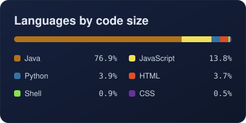

## 이승민 // Backend Developer

<table>
<tr>
<td></td>
<td>포트폴리오 · 프로젝트 화면</td>
</tr>
<tr>
<td></td>
<td>DevScene · 하루 1분 개발 개념 쇼츠, 주제별로 묶은 롱폼</td>
</tr>
<tr>
<td></td>
<td>DevScene · 하루 1분 개발 개념 릴스</td>
</tr>
<tr>
<td></td>
<td>seungmin6385@gmail.com</td>
</tr>
</table>

## Projects

### [Salus](https://github.com/smin0111/Salus/tree/develop) — 알레르기·건강 정보를 반영해 레시피를 알려주는 로컬 LLM 식생활 서비스

> `2026.01 ~ 현재` | 개인 프로젝트 (5인 팀 프로젝트로 시작해 2026.06부터 혼자 개발) | 기획 · 백엔드 · 운영

알레르기·건강 정보를 한 번 등록해 두면, 레시피마다 먹어도 되는지 알아서 판단해 주는 서비스입니다.

**구현한 것**

- 웹 레시피 페이지에서 재료·단계를 그대로 꺼내 오는 추출 (JSON-LD 우선, 없으면 `gemma3:4b`)
- 버터·치즈처럼 우유로 만든 재료까지 잡아내는 알레르기 사전과 판정 로직
- 실제 판정 코드로 채점하는 평가 하네스로 로컬 모델 8개 비교
- 소셜·이메일 로그인과 계정 연결, 포트원 V2 결제 금액 대조
- 맥북 베타 서버 운영, 암호화 백업·복구 확인

<b>해결한 문제</b>

- LLM이 레시피를 지어냄 → 웹 레시피를 그대로 꺼내 오도록 바꿔, 처음 보는 요리 14개 모두 출처 확보
- 같은 코드인데 평가 결과가 매번 다름 → JVM마다 바뀌던 `Map.of` 순서를 고정해 3회 반복 결과 일치
- 버터가 남은 레시피를 "우유 제외"로 안내 → 파생 원료까지 판정해 실전 질문 43개에서 알레르기 위반 1 → 0건
- 등록 알레르기 '오이'를 '오'로 잘라 판정 → 등록된 이름은 자르지 않도록 고치고 회귀 테스트 추가

---

### [HulaHoop Gateway](https://github.com/HulaHoop-Gateway) — AI 채팅으로 영화 예매·공유 전기자전거 대여의 실제 예약·결제·취소로 잇는 O2O 플랫폼

> `2025.10 ~ 2025.12` | KD아카데미 팀 프로젝트 (4인) | PM · 백엔드 | 팀 병합 PR 139건 중 78건(56%) 작성

여러 AI 서비스와 예약 플랫폼을 하나의 게이트웨이로 잇는 프로토타입입니다.

**구현한 것**

- Spring Cloud Gateway가 `intent`를 보고 영화·전기자전거 서버로 라우팅
- AI 대화로 상영 일정·좌석 선택·결제·예약·취소까지 이어지는 예매 흐름
- 여러 좌석을 `bookingGroupId`로 묶어 한 번에 조회·취소·환불
- 두 서비스의 결제·환불을 한곳에 모은 관리자 거래 통계
- Docker Compose로 컨테이너 10개 AWS 배포 (배포 저장소 커밋 60개 작성)

<b>해결한 문제</b>

- 결제에 실패해도 좌석이 묶임 → Toss Payments 승인 뒤에 예약을 확정하도록 순서 변경
- 모든 사용자가 대화 상태 하나를 공유 → 인증된 사용자 ID별로 대화와 예매 단계 분리
- 컨테이너 시간대가 UTC라 예약 날짜가 하루 밀림 → JVM 시간대를 Asia/Seoul로 설정

---

## Skills

<table>
<tr>
<td width="50%" align="center" valign="top">
<h4>Language</h4>

</td>
<td width="50%" align="center" valign="top">
<h4>Backend</h4>

</td>
</tr>
<tr>
<td width="50%" align="center" valign="top">
<h4>Data & AI</h4>

</td>
<td width="50%" align="center" valign="top">
<h4>Frontend & app</h4>

</td>
</tr>
<tr>
<td width="50%" align="center" valign="top">
<h4>Infra & DevOps</h4>

</td>
<td width="50%" align="center" valign="top">
<h4>Payments & tools</h4>

</td>
</tr>
</table>

## GitHub

## Education & Certification

- KD아카데미 풀스택 개발자 과정 수료 `2025.06 ~ 2025.12` (팀 프로젝트 2회 팀장·PM)
- 정보처리산업기사 `2025.06`
